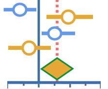
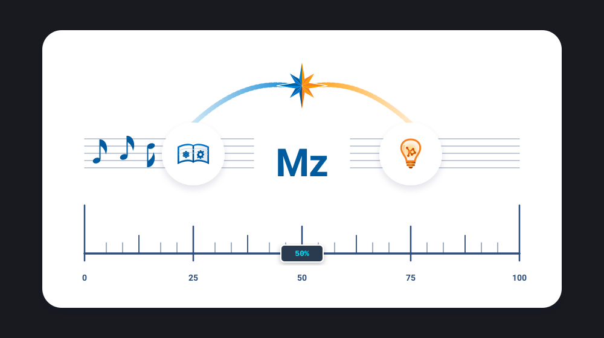

# Metafora: A Unified Synthesis Tool

<br clear="left" />

<p align="center">
  
</p>

> The musical score represents code: its rigor, precision, and the beauty of a universal language. Reading and understanding the work of others sparks new ideas—the light bulb—which find room on an empty staff to become new music, new code. **Mz** is the author's personal signature on this journey: understanding, creating, and sharing, rather than merely copying.


**Metafora 2.0.0** is a meta-analysis module for **jamovi**, using the **metafor** R package. The current Windows candidate bundles **metafor 5.3-4**. Its dependency source is pinned in DESCRIPTION for reproducible builds. The declared minimum jamovi version is **28.17.0**; this lower bound does not imply that an unmodified 28.17 desktop contains the upstream Svg fixes described below.

Development validation uses Windows jamovi 28.17 and the local portable 28.17.2 with core fixes. Automated tests cover all six models. The maintainer has visually accepted the updated development features and the latest Model-tab layout and Results ordering. Linux has already passed the previously recorded development checks; that acceptance is retained. The latest layout, Results-order and documentation refinements do not change the statistical algorithms or platform-specific Linux code. Producing an updated Linux JMO is a packaging step, not a withdrawal of the existing Linux acceptance. macOS package preparation and validation remain separate.

Designed as a **unified synthesis tool**, it provides a streamlined and statistically rigorous interface for researchers to aggregate data across six core models: correlations, dichotomous outcomes, pre-calculated effect sizes, mean differences, proportions, and Cronbach’s alpha.

## Six analysis models

Each analysis combines study-level summaries. Select the study label and the required numeric columns, then choose an effect measure and estimation method. Subgroup analysis and study-level moderators are available across the six analyses; their availability in individual plots and optional methods is described below.

| Analysis | Study-level inputs | What it synthesizes | Effect measures |
| --- | --- | --- | --- |
| Dichotomous Models | Events and non-events in experimental and control groups | Differences in binary outcomes between two groups | Risk ratio, odds ratio, Peto odds ratio, risk difference and arcsine difference |
| Mean Difference Models | Sample size, mean and SD in each of two groups | Differences in continuous outcomes | Raw mean difference, standardized mean differences with supported variance/scaling variants, and ratio of means |
| Generic Effect Sizes | An effect estimate and its sampling variance or SE; supported confidence-limit input | Previously calculated effect estimates on a common analysis scale | Generic inverse-variance synthesis; the input effect scale determines interpretation |
| Correlation Models | Correlation and sample size | Associations across studies | Raw, corrected and Fisher-z-transformed correlations |
| Proportion Models | Events and total sample size | A single-group proportion across studies | Raw, log, logit, arcsine, Freeman–Tukey and probit transformations |
| Reliability Generalization | Cronbach’s alpha, number of items and sample size | Internal-consistency reliability across studies | Raw alpha, Hakstian–Whalen and Bonett transformations |

The Model tab offers common-effect or random-effects estimation, supported heterogeneity estimators, z/t/Knapp–Hartung inference and a configurable confidence level. Reported model estimates, heterogeneity, subgroup results and optional fit/comparison tables follow the selected model. Study-level meta-regression is not an individual-participant analysis; moderators do not automatically define a pooled effect that applies to every moderator value.

## Graphs, tables and optional analyses

| Area | Available output | Main conditions and distinctions |
| --- | --- | --- |
| Forest | Classic Image or Interactive Svg, study weights, subgroup summaries, row shading, native/interactive tables and configurable axes | All six analyses; moderator models use the documented descriptive references instead of an unadjusted pooled summary |
| Prediction intervals | Line with limits, Diamond, Bar, Shaded bar or Distribution in Classic Forest | Random-effects models without moderators; at least two studies for each prediction; distinct from confidence intervals for the mean effect |
| Risk of bias | Colored judgment columns in Classic and Interactive Forest | Dichotomous, Mean Differences and Generic Effect Sizes; uses supplied study judgments and does not calculate an overall rating |
| Funnel | Classic and Interactive views, axis/region options and supported enhanced or sunset views | All six analyses; moderator models use residuals rather than the ordinary pooled-effect reference |
| Diagnostics | Influence, normal Q–Q, likelihood, moderator scatter, radial, Baujat and GOSH views | Availability depends on the fitted model and each method’s requirements; not every diagnostic is meaningful for every input choice |
| Sensitivity | Cumulative meta-analysis and Leave-One-Out, with independent tables and Classic/Interactive plots | Without moderators; subgroup-aware sequences and supported prediction limits; see the detailed conventions below |
| Equivalence and publication bias | TOST, supported bias tests, Trim-and-Fill, selection models, p-uniform and p-curve output | Optional procedures with their own assumptions and restrictions; not interchangeable evidence of publication bias |
| Predictive probability | Independent probability table and density plot for Above/Below an effect threshold | Random-effects models without moderators; scale restrictions and interpretation are detailed below |
| Heteroscedasticity | Native metafor Score test with configurable parametric bootstrap | ML/REML, without moderators; tests unequal heterogeneity variances rather than whether heterogeneity is zero |
| Reporting and saving | Optional text report, study-level output variables and jamovi document/export facilities | The text report has the stated restrictions; saved documents preserve the analysis, while study-level outputs add the selected quantities to the dataset |

Interactive zoom, row/column controls and linked study selection apply where offered by the specific view. They are presentation features and do not alter the fitted model. Detailed conditions are available in each tab’s **Info & Notes**.

## Key Innovations in Version 2.0.0
While Metafora serves as the spiritual successor to the **MAJOR** module, it is a **complete ground-up rewrite**. This new version has been developed to address long-standing community feedback and to ensure compatibility with modern statistical environments.

* **Integrated Subgroup Analytics:** Direct support for visualizing subgroups within forest plots, including the ability to display integrated summary tables alongside plot estimates.
* **Enhanced Graphical Suite:** A diversified range of funnel plots and specialized diagnostic visualizations, offering more flexibility than standard defaults.
* **Custom-Built UI:** A fully bespoke user interface designed from scratch to handle complex specifications intuitively, reflecting years of user requests from the jamovi community.
* **Shared Statistical Services:** Cached model and diagnostic results, with explicit invalidation when their inputs change. Interactive D3 forest, funnel, sunset, leave-one-out and cumulative plots complement the Classic Image plots. Interactive Forest Tables provide column tools, subgroup summaries, zoom and linked study selection.

## Origins & Credits
Metafora was created to evolve the capabilities of meta-analysis within jamovi. While the codebase, UI, and expanded feature set are entirely new, this project acknowledges its origins and the initial inspiration provided by the **MAJOR** module.

Special thanks to **W. Kyle Hamilton**, the author and creator of MAJOR, for his pioneering work in bringing meta-analysis to the jamovi platform. Metafora carries that legacy forward into a new architectural framework to meet the current needs of the research community.

## Installation & Resources
Metafora 2.0.0 is undergoing local validation. Public distribution through the jamovi library or GitHub releases has not been completed.

To build from a clone, install R, a compatible jamovi application and `jmvtools`. From an R session whose working directory is the cloned module root, run:

```r
install.packages("jmvtools", repos = c("https://repo.jamovi.org", "https://cloud.r-project.org"))
jmvtools::check()
jmvtools::install()
```

If jamovi is installed outside the locations detected by `jmvtools`, set `options(jamovi_home = "path/to/your/jamovi")` before checking and building. Install any platform build tools required by R dependencies. The resulting module targets the jamovi runtime and platform used for that build. See the [official jamovi development setup](https://dev.jamovi.org/tutorial/tuts0101-getting-started/).

The repository includes the runtime JavaScript/CSS bundles in `inst/extdata`; building the module does not require regenerating these bundles or running a local `compile.r`. Modular bundle sources and author-specific build procedures are not included. Restart an open analysis view to load changed UI resources after an update.

Version 2.0.0 replaces MAJOR without migrating saved MAJOR analyses. Datasets can be reused to create new analyses. Saving and reopening analyses created with Metafora is supported and tested separately.

## Current compatibility status

Interactive Forest plots use the native jamovi `Svg` result in all six models. The other interactive plot views retain their existing HTML implementation; Classic plots use native Image results.

On unmodified jamovi 28.17, native Svg results can prevent saving an `.omv` document ([issue #1907](https://github.com/jamovi/jamovi/issues/1907)). The fix from [PR #1909](https://github.com/jamovi/jamovi/pull/1909) is merged in the upstream sources; an official desktop release containing it still needs to be verified. Windows development checks also use a local correction that preserves Svg figure proportions in DOCX/ODT exports. These local fixes are not part of a published Metafora package. The minimum official jamovi version for a public release will be set after the required fixes are available and verified. LaTeX export remains a separate upstream issue ([#1902](https://github.com/jamovi/jamovi/issues/1902)).

## Example datasets

Open **Data Library → Metafora** to access six illustrative datasets with saved analyses, one for each model. The proportions dataset contains two analyses. The examples include the updated native Forest results and can be edited and saved as new `.omv` documents.

## Heteroscedasticity test

In all six analyses, **Model → Display Options → Heteroscedasticity test** enables native `metafor::hettest()` with its default **Score** test. **Bootstrap samples**, below the checkbox, controls the number of parametric bootstrap iterations (default **1,000**; whole numbers from **100 to 100,000**). It tests whether the true-effect heterogeneity variance is common across studies. This is different from the usual Q test of zero heterogeneity.

The initial implementation requires an **ML or REML model without moderators** and at least two included studies. The checkbox is enabled only for ML or REML and is disabled for other estimators. Hover or focus its disabled label to see “Requires ML or REML estimation.” Estimator changes do not generate an additional toast. Activation with moderators is blocked with an informational toast; an already selected result is hidden with an explanation when its conditions become unsupported. Estimator changes preserve the stored selection. One overall test is reported, including when a Subgroup variable is supplied. The table contains k, estimator, test, statistic, df, bootstrap p-value and successful/total bootstrap iterations. Other native hettest test types are not exposed in this initial interface.

The sample-count field is available when the test is selected, the estimator is ML/REML and no moderators are supplied. Changing its value repeats the bootstrap using the cached main fit; its value is retained when the test is switched off. The bootstrap uses fixed seed `20261115` for reproducibility, restores the preceding random-number state and retains native metafor calculations. Bootstrap p-values have Monte Carlo uncertainty. The numerical result is cached independently of display choices and reused after restoring the analysis when its numerical inputs are unchanged. The main meta-analysis fit is reused; metafor performs the additional fits required by its bootstrap procedure. See the [native hettest documentation](https://wviechtb.github.io/metafor/reference/hettest.html).

## Text reporting with moderators

Text reporting retains its Html result for the Methods/Results report. With moderators present, attempting to select Text reporting shows an informational toast and leaves the checkbox off. Adding moderators to a selected report hides the report and shows the explanation; removing them restores the selected report. These notices do not add animated SVG or informational placeholder content to Results. Existing report restrictions on the test, study weights and study count remain unchanged.

## Numeric input formatting

Custom numeric controls follow jamovi’s **Decimal symbol** preference (Dot or Comma), independently of the operating system locale and interface language. Decimal entry, step buttons, keyboard stepping and sliders share the same numeric values. Changing the preference updates the displayed separator without changing option values. Either decimal separator is accepted when typing or pasting a single number; thousands separators and mixed separator strings are not supported. Incomplete or invalid text does not replace the current value with zero. Step buttons sit beside the field so they do not cover its digits. Results formatting remains controlled by jamovi.

## Predictive probabilities

All six analyses offer **Model → Predictive probability**. Expand the group, enter an **Effect threshold**, choose **Below threshold** or **Above threshold**, and enable the probability table, the plot, or both. These outputs are off by default and require a random-effects model without moderators and at least two included studies.

The result is the model-based probability that the **true effect in a new study from the same population** is below or above the threshold. It is not the probability that the pooled mean is below or above it. Calculations use native `metafor::predict(..., prob=...)`, including uncertainty in the estimated mean and the normal or t predictive distribution appropriate to the fitted model.

Enter thresholds on the natural effect scale: RR/OR or ratio of means (positive), raw or standardized mean difference, correlation (strictly between −1 and 1), alpha or proportion (strictly between 0 and 1), or the supplied scale for Generic Effect Sizes. For example, with Risk Ratio, a threshold of `0.8` and Below asks about a new true RR below 0.8. The Freeman–Tukey double-arcsine proportion measure (PFT) is excluded because its inverse requires a reference sample size. Unsupported models or invalid thresholds show an explanation without interrupting other results.

The blue area marks the requested tail; the orange line marks the threshold. The graph shows the central 99% of the predictive distribution, while the probability uses its full range. If the threshold is outside the displayed range, its line is placed at the boundary and the note explains this. For transformed measures, tick labels show natural effects but coordinates and density remain on the analysis scale; the density is not a back-transformed density. Native approximations are retained, without truncating distributions at natural parameter bounds. Subgroup selection can affect included cases; this output describes the overall model, not separate subgroup predictions.

With moderators selected, attempting to enable Plot or Table shows an immediate informational toast and leaves the checkbox unchecked, without changing the backend option. If moderators are added to an analysis that already has predictive outputs selected, those outputs are hidden; existing selections can still be switched off. Removing moderators makes retained selections available again.

Threshold, direction and display changes reuse the main fit. The plot uses a native resizable Image result and supports restoration and export from its stored state. Windows GUI save/reopen and export checks for this new output remain to be confirmed on the development portable before release.

## Inputs and interactive results

Generic Effect Sizes accepts effects with sampling variances, standard errors or confidence limits. Variance is the default; SE values are squared internally. CI input requires lower and upper limits and the original interval level. Variances are approximated from normal-based Wald interval widths on the supplied effect scale; the input interval level is independent of the model output confidence level.

In the Generic Effect Sizes Classic forest, subgroup and overall Summary rows report the pooled model estimate in ES and its squared model SE in Variance, on the analysis scale. These are not sums of study effects or sampling variances. Pooled summary values are omitted for models with moderators.

For all six models, **PI style** offers Line with limits (the default), Diamond, Bar, Shaded bar and Distribution, using native metafor rendering. Enable Overall and Prediction Interval in a random-effects model without moderators. At least two studies are required for a prediction, including within each subgroup. Extended styles reserve a separate prediction row and print its interval limits. The pooled diamond remains the confidence interval for the mean effect; the prediction describes the true effect in a new study. Styles do not change the fit, the selected test or interval level, or the Interactive forest. No simulated or externally supplied predictive distribution is generated by this selector.

**Show RoB** uses one switch for both Classic and Interactive Forest plots in Dichotomous, Mean Differences and Generic Effect Sizes analyses. Select the supplied judgment columns in Risk of Bias Domains. Low risk is green with a plus, Some concerns/Unclear is orange with a question mark, High risk is red with a minus, and missing/unrecognized judgments are gray. Ratings annotate retained studies without changing the fit or computing an overall judgment. Classic extends Shade Rows across the judgment columns and keeps a compact vertical legend below Overall, or a horizontal legend directly below the notes in moderator models; D1–D5 use compact spacing, with an additional gap before OA, the Classic heading for an Overall column. The legend defines OA as Overall risk of bias; dataset column names remain unchanged. Other long column headings use unique keys with their full names below the graph. Show RoB and Shade Rows remain selectable in every Forest plot mode, including Off, and with or without subgroups. Off hides the plot; RoB annotations require supplied judgment columns.

Cumulative meta-analysis is available in Diagnostics for all six models without moderators. Its table and Classic/Interactive plot support study ordering. Both plots display p-values, between-study variance and standard deviation, and I-squared beside the effect and confidence interval, with the model and estimator below. Optional prediction intervals for a new true effect use native metafor refits of each prefix and require at least two studies; heterogeneity is unavailable at a single-study step. Intermediate p-values do not define a sequential stopping rule.

Leave-One-Out offers Classic, Off and Interactive plot modes with an independent HTML D3 table. Both plots use the same cached estimates and confidence limits, original pooled comparisons within each subgroup, additional statistics and optional prediction intervals. The Classic representation uses metafor's forest renderer; the Interactive representation uses D3.

Forest Tables share study hover and pin with Interactive Forest, Funnel, Sunset and Leave-One-Out views of the same analysis. Internal row identities distinguish repeated labels. Zoom expands the whole table; use the Results page to scroll. View settings are retained in the current Results session, independently of statistical options. Static complete tables remain available for print, export and fallback without JavaScript.

## Development checks

After building and installing the package in an R library available to the test runtime, run from the module source root. For runtime integration checks, use R bundled with the target jamovi application and make its module libraries available; a successful test in an unrelated host R session is not a substitute for that check:

```r
library(Metafora)
testthat::test_dir("tests/testthat")
```

The R suite covers all six model types, native metafor references, inference, subgroup alignment and cache invalidation. Browser/UI tests and visual validation in jamovi complement it; R tests alone cannot verify interactive rendering or flashing.

The scripts in `tests/ui` also run independently with Node.js, for example `node tests/ui/predictive_probability_config.test.js`. Run all six scripts for the UI regression check. They use built-in Node modules and the included JavaScript/YAML sources; no private workspace paths or local bundle generators are required.

The module currently uses English user-facing text. Code comments are maintained in Italian. No translation catalogs are supplied at this stage.

Optional p-curve output uses two-sided Wald z study p-values. P-uniform confidence intervals are fixed at 95% by the library; its alpha option selects significant studies and does not change the confidence level. Selection models can return unavailable uncertainty estimates when the Hessian cannot be inverted; convergence and uncertainty must be assessed separately. Freeman-Tukey (PFT) estimates and intervals remain on the double arcsine scale in all outputs; back-transformation is unavailable because the pooled inverse requires a reference sample size.

For common-effect Leave-One-Out analyses, tau-squared and tau are not estimated and their columns are omitted from plots and tables. A result note and a transition-only informational toast explain this convention; other software may report separate heterogeneity estimates alongside common-effect results.

Cumulative common-effect output follows the same convention: tau and tau-squared columns are omitted from both plots and the table, with an explanatory note and informational toast. Random-effects output orders these statistics as p-value, I-squared, tau and tau-squared.

Classic and Interactive Funnel plots share metafor's statistical meaning: a pooled-effect reference without moderators, and model residuals with their corresponding standard errors around zero for meta-regression. Pseudo confidence regions and alternative axes follow the native method. The ordinary plot contains observed studies; Trim-and-Fill remains a separate sensitivity analysis. Interactive study identities preserve links with Forest plots and tables.


## Source repository and development status

This 2.0.0 source project is intended for the new `MAgojam/Metafora` repository, independently of the previous legacy project. Source availability does not mean that validated release packages exist for all four platforms. Platform packages and release acceptance will be documented separately.

The Model tab places Heteroscedasticity test and Bootstrap samples before Heterogeneity comparison, Display model fit and Text reporting. Predictive probability is alongside it; its threshold field aligns with Bootstrap samples and its Direction title aligns with Display model fit. The Results sequence places the heteroscedasticity table after Subgroup Analysis and before Heterogeneity comparison and model fit.

For contributors, the order of entries in each analysis `.r.yaml` determines the vertical order of Results. Place new result objects deliberately and keep their hidden cache immediately before the associated result where that convention applies. The `.a.yaml` option order and custom control layout do not reorder Results. Parallel model definitions should retain the same common Results sequence.

## License and third-party notices

This module is distributed under the **GNU General Public License (v2 or later)**; see [COPYING](COPYING). The bundled D3 7.9.0 library uses the ISC license, retained in [inst/licenses/D3-LICENSE.txt](inst/licenses/D3-LICENSE.txt). See [THIRD_PARTY_NOTICES.md](THIRD_PARTY_NOTICES.md) for bundled-component and R-dependency notices.
